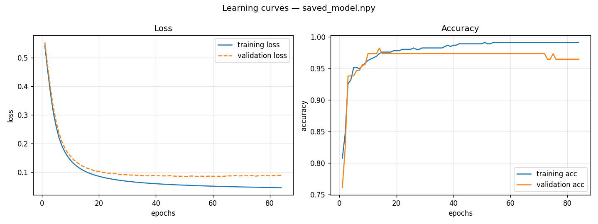
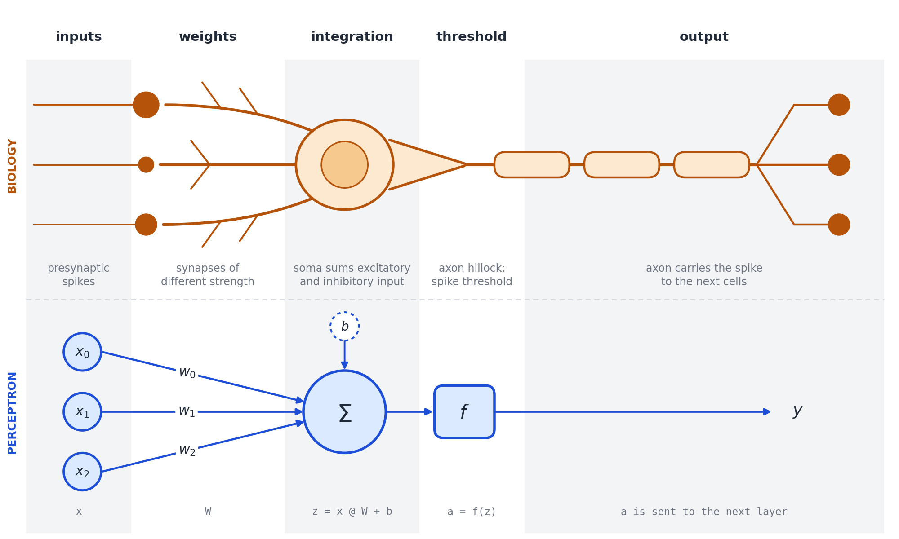

# Multilayer Perceptron

A multilayer perceptron written from the ground up to tell malignant (`M`) breast
tumours from benign (`B`) ones, using the Wisconsin diagnostic dataset.

The rule of the game was: no TensorFlow, no PyTorch, no scikit-learn. numpy does the linear algebra,
matplotlib draws the curves, and everything else must be written from scratch.

**Result:** 96-97% accuracy on the test set, with an average loss down to 0.09 (80/20 split, seed 42).



---

## The data

The Wisconsin Diagnostic Breast Cancer dataset (Wolberg, Street &
Mangasarian, via UCI) has 569 samples: 357 benign + 212 malignant. Each one
comes from a fine-needle aspirate, where a thin needle takes a few cells
from the lump. The sample is imaged and the nuclei are outlined
semi-automatically. Ten shape measurements are taken per nucleus (radius,
texture, perimeter, area, smoothness, compactness, concavity, concave
points, symmetry, fractal dimension) and summarised three ways for each
image: 1. the mean, 2. the standard error, and 3. the 'worst' value ( = the mean of
the three largest). Ten measurements times three summaries gives the 30
features.

The signal is old-fashioned cytology. Malignant nuclei tend to be bigger
and more irregular than benign ones, which is called nuclear
pleomorphism. In this data the mean radius is about 44% larger in the
malignant samples, and the concave-points measure is more than three times
higher. The network is never told any of this. It gets 30 columns of
numbers and a label.

## 🚀 Quick start

```bash
pip install -r requirements.txt

make split      # splits the dataset into training / validation
make train      # trains and saves the model
make predict    # evaluates the model on the validation set
```

Running the scripts directly (or if you not have
`make`):

```bash
python split.py data/data.csv --validation-ratio 0.2 --seed 42

python train.py --train data/data_training.csv --valid data/data_validation.csv \
                --layer 24 24 --epochs 84 --batch_size 8 \
                --learning_rate 0.0314 --loss categoricalCrossentropy

python predict.py --model saved_model.npy --dataset data/data_validation.csv
```

## ⚙️ Configurability

Architecture and parameters can be passed as arguments or through a
JSON file (`configs/network.json`). The command line wins over the
file.

```bash
python train.py --config configs/network.json
python train.py --config configs/network.json --optimizer adam --learning_rate 0.001
python train.py --layer 32 16 8 --activation relu --early-stopping 15
```

| Option | Values |
|---|---|
| `--layer` | hidden layer sizes, at least two |
| `--activation` | `sigmoid`, `tanh`, `relu` |
| `--initialiser` | `heUniform`, `heNormal`, `glorotUniform`, `glorotNormal` |
| `--loss` | `categoricalCrossentropy`, `binaryCrossentropy` |
| `--optimizer` | `sgd`, `momentum`, `nesterov`, `rmsprop`, `adam` |
| `--early-stopping` | patience in epochs, `0` to disable |

## 📁 Structure

```
.
├── mlp/                  the core, one file per responsibility
│   ├── activations.py    sigmoid, tanh, relu, softmax + derivatives
│   ├── initialisers.py   heUniform, glorotUniform, ...
│   ├── layers.py         DenseLayer: forward / backward of a layer
│   ├── network.py        Network: stacks layers, propagates
│   ├── losses.py         cross-entropies
│   ├── optimizers.py     SGD, momentum, Nesterov, RMSprop, Adam
│   ├── callbacks.py      early stopping
│   ├── model.py          create_network / fit / predict
│   ├── dataset.py        CSV parsing, stratified split, normalisation
│   ├── metrics.py        accuracy, precision, recall, F1, confusion matrix
│   ├── persistence.py    model saving and loading
│   └── plotting.py       learning curves
├── split.py              ┐
├── train.py              ├ the three programs the brief asks for
├── predict.py            ┘
├── tools/                gradient check, model comparison
├── configs/              training configurations
├── docs/images/          figures used in this README
└── data/                 the dataset (generated splits are not versioned)
```

One file, one responsibility. `fit` calls the
network → the network calls its layers → each layer calls its activation.
Nothing knows about anything above it, so the project can be read from the
bottom up without having to backtrack.

## Key factors that actually improve the results

**Normalisation.** The raw columns run from about 0.05 to 2500. Features with large numbers dominate the calculation and push the sigmoid function into its flat extremes. In these flat zones, the mathematical gradient drops to near zero, stopping the network from learning. So every column is centred and scaled with the training-set mean and standard deviation, and those two numbers are saved inside the model so that predict.py applies the exact same mean and standard deviation. (Calculating them across all rows at once would leak test data into the training phase, giving the model an unfair preview of unseen cases.) Brains have a version of the same problem: neurons have to keep their firing in a usable range whatever the strength of the input, and they manage it with mechanisms such as synaptic scaling (Turrigiano et al., 1998) and divisive normalisation (Carandini & Heeger, 2012). Same motivation, different machinery.

**Balanced class split (stratified split).** Both halves keep the same M/B ratio (about 37% malignant). A stratified split simply means keeping the proportions balanced: both the training and validation sets end up with the same 37% ratio of malignant cases. Without this stratification, a random draw could place an unrepresentative number of malignant cases into one set, meaning our validation score would simply reflect a biased split rather than true model performance.

**Minimising false negatives (recall over accuracy).** Missing a malignant tumour is far worse than a false alarm, so recall on the M class is the number I look at first. It is the hit rate of signal detection theory. The network outputs a probability: anything above 0.5 is called malignant, but 0.5 is only a decision criterion. Lowering it buys more hits at the price of more false alarms, shifting the balance between catching more tumours and triggering more false alarms. Where to put it is a question about costs, not about the network.

## 🧬 From neuron to perceptron

The vocabulary is not an accident. McCulloch and Pitts described the
neuron as a threshold unit in 1943, and Rosenblatt's perceptron followed
from that idea in the late 1950s. Below, each stage of a real neuron is
lined up against the matching piece in this project. The easiest 
way to see what a line of code stands for is to show what it replaces.
The biology is simplified on purpose.



*A generic neuron (top) and a perceptron (bottom). Heavily simplified:
three inputs, no glia, no dendritic spines, no neuromodulation.*

### Biological parallels

| Biology | This project |
|---|---|
| Presynaptic activity arriving on the dendrites | the inputs `x` |
| Synaptic efficacy: how strongly one spike moves the membrane potential | the weights `W`; a negative weight plays the part of an inhibitory synapse |
| Summation of excitatory and inhibitory potentials at the soma | `a_prev @ W` in `layers.py` |
| Gap between resting potential and spike threshold | the bias `b` |
| Firing rate against input current (the f-I curve): a threshold, a rise, then saturation because of the refractory period | the activation function: sigmoid has the saturation, ReLU has the threshold and the linear rise |
| Two populations competing through mutual inhibition | softmax on the output layer: the two probabilities must sum to 1, so one can only rise at the other's expense |
| Synaptic plasticity: experience changes connection strengths, not the wiring | gradient descent: `W -= learning_rate * dW` |

In other words: think of a real neuron as a small biological calculator. It collects chemical signals across thousands of tiny input branches (dendrites), combines them in its cell body, and fires an electrical pulse down its axon if the total signal crosses an activation threshold. 
In code, we mimic this exact sequence with basic algebra: multiply incoming numbers by weights, add them together, add an adjustable baseline (bias), and run the result through an activation function to determine how strongly the neuron activates the next layer.

The last row has a famous ancestor. Hebb's 1949 postulate says that when one cell repeatedly takes part in firing another, the connection between them is strengthened. The famous phrase - "cells that fire together, wire together" - is often attributed to Donald Hebb, but it was actually coined decades later in 1992 by neurobiologist Carla Shatz, giving credit back to its rightful author. Gradient descent is not Hebbian, though, and that is where the analogy starts to strain.  

---

### Divergences and biological limits

**1. Reusing connections backwards.**  
In `layers.py`, backpropagation updates the network by calculating the mistake at the end, and then working backwards using the exact same connection strengths that were used on the way forward (`self.W.T`). While this works well on a computer, it does not happen in human tissue. Biological synapses are strictly one-way: an action potential travels down the axon, releases neurotransmitters, and affects the next cell. The receiving cell has no physical way to send that information backwards or mirror that connection strength in reverse (Grossberg, 1987). Real biological plasticity relies on local signals between two direct neighbours. A single synapse does not receive a global error message from the whole network telling it exactly how much to change. How real brain circuits know which specific cells need to adjust when a mistake happens across multiple layers is still an open puzzle in neuroscience (Lillicrap et al., 2016, 2020).

**2. Time and rhythms: static snapshots vs. living spikes.**  
In this project, the `forward()` function processes all 30 features at once in a single calculation. An artificial neuron only outputs a single static number, treating activity like an average firing speed. In living brains, timing matters. Neurons communicate through rapid electrical pulses (action potentials). Real biological processing depends heavily on time: bursts of activity, refractory periods (the brief pause while the cell resets before it can fire again), and the precise arrival time of individual pulses. If an electrical pulse arrives just five milliseconds earlier or later, it can completely change whether a connection strengthens or weakens. This temporal dimension is missing in a snapshot-based model.

**3. Fixed cell identities.**  
During training with gradient descent (the step-by-step mathematical adjustment that reduces errors), an artificial weight can easily switch between positive and negative numbers. A single artificial unit can have positive weights to some neighbours and negative weights to others (meaning it can stimulate one cell to fire while actively silencing another). Real neurons have a fixed identity based on the main chemical they produce: excitatory cells release glutamate to activate their targets, while inhibitory interneurons release GABA to calm things down. The brain does not flip connection signs randomly. Instead, it balances excitation and inhibition by directing signals through specialised inhibitory circuits, while chemicals like dopamine and acetylcholine modulate how easily connections change.

**4. Simple nodes vs. complex biological branches.**  
In code, an artificial neuron is heavily simplified: it multiplies its inputs by weights, sums them up, and applies an activation threshold. For example, with a ReLU function, if the incoming sum is negative the output stays at 0, and if it is positive the value passes through. Real neurons are far more complex than a single formula. Their large branching trees (dendrites) contain active ion channels that can filter, boost, and process signals locally before the signal even reaches the cell body. In fact, biophysical studies show that mimicking the detailed input-output behaviour of just one pyramidal cell can require a deep artificial network of five to eight layers (Beniaguev et al., 2021). What we represent with a single unit in `DenseLayer(24)` is closer to a small biological circuit on its own.

**5. Static wiring vs. living connections.**  
In `train.py`, the network layout is set in stone before we even start: the number of layers and connections never changes, and learning only adjusts numerical weights. Living nervous systems physically change their wiring over time. The brain constantly grows new connections and trims away inactive ones (synaptic pruning). Because maintaining synaptic connections consumes a large amount of metabolic energy in the form of ATP, biological circuits physically remove unused pathways to stay efficient while adapting to new challenges.

---

Artificial neural networks were never meant to be exact biological simulations; they are mathematical tools inspired by neuroscience and adapted for step-by-step learning on a computer. Comparing the two is not about finding flaws in the code, but about appreciating the contrast between biological neural circuits shaped by evolution and practical algorithms built to solve tasks on modern machines.


## 📚 References

- Beniaguev, D., Segev, I. & London, M. (2021). Single cortical neurons as
  deep artificial neural networks. *Neuron*, 109.
- Carandini, M. & Heeger, D. J. (2012). Normalization as a canonical
  neural computation. *Nature Reviews Neuroscience*, 13.
- Grossberg, S. (1987). Competitive learning: from interactive activation
  to adaptive resonance. *Cognitive Science*, 11.
- Hebb, D. O. (1949). *The Organization of Behavior*. Wiley.
- Lillicrap, T. P., Cownden, D., Tweed, D. B. & Akerman, C. J. (2016).
  Random synaptic feedback weights support error backpropagation for deep
  learning. *Nature Communications*, 7.
- Lillicrap, T. P., Santoro, A., Marris, L., Akerman, C. J. & Hinton, G.
  (2020). Backpropagation and the brain. *Nature Reviews Neuroscience*, 21.
- McCulloch, W. S. & Pitts, W. (1943). A logical calculus of the ideas
  immanent in nervous activity. *Bulletin of Mathematical Biophysics*, 5.
- Rosenblatt, F. (1958). The perceptron: a probabilistic model for
  information storage and organization in the brain. *Psychological
  Review*, 65.
- Rumelhart, D. E., Hinton, G. E. & Williams, R. J. (1986). Learning
  representations by back-propagating errors. *Nature*, 323.
- Street, W. N., Wolberg, W. H. & Mangasarian, O. L. (1993). Nuclear
  feature extraction for breast tumor diagnosis. *SPIE Proceedings*, 1905.
- Turrigiano, G. G., Leslie, K. R., Desai, N. S., Rutherford, L. C. &
  Nelson, S. B. (1998). Activity-dependent scaling of quantal amplitude in
  neocortical neurons. *Nature*, 391.
- Wolberg, W., Mangasarian, O., Street, N. & Street, W. *Breast Cancer
  Wisconsin (Diagnostic)*. UCI Machine Learning Repository (CC BY 4.0).


